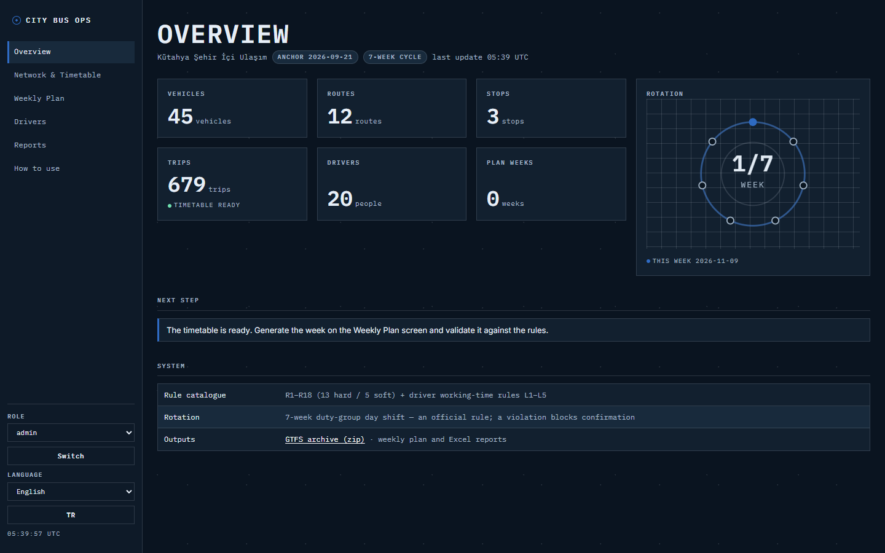
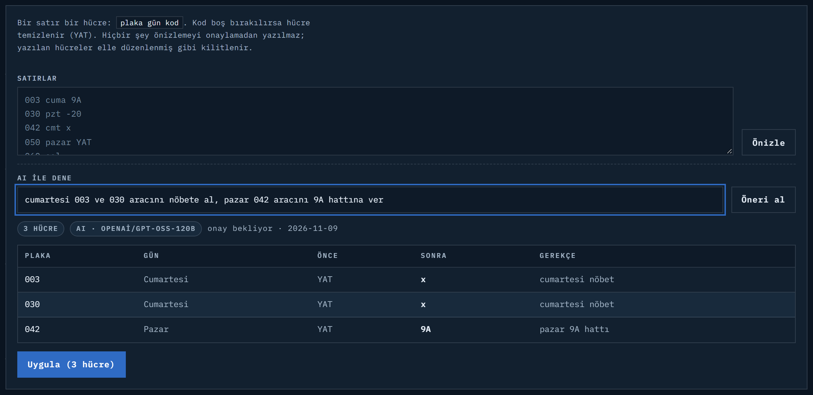

# City Bus Ops

**English** · [Türkçe](README.tr.md)

**Vehicle blocking, driver duties and the 7-week rotation law for a municipal city-bus fleet — as a Windows desktop application that runs entirely offline.**

[](LICENSE)
[](tsconfig.base.json)
[](#verification)
[](#the-desktop-app)
[](.nvmrc)



A depot planner publishes the next week's duty plan twice a week: which bus covers which route,
which driver takes which run, in which order — under a rotation law that must not be violated
(the fair distribution of the hard early/late shifts), plus legal rest limits and the union
agreements the operation actually lives by.

This repository is that tool. It replaces a single-user Excel workflow with something that
knows the rules, keeps an audit trail, exports the same printed sheet the drivers' room still
uses, and exports the schedule as **GTFS** so the data can leave the building when it has to.

---

## Table of contents

- [What it does](#what-it-does)
- [Screens](#screens)
- [The rotation law](#the-rotation-law)
- [The rule engine](#the-rule-engine)
- [The planning assistant](#the-planning-assistant)
- [Architecture](#architecture)
- [Quick start](#quick-start)
- [Verification](#verification)
- [Data, privacy, offline-first](#data-privacy-offline-first)
- [Repository layout](#repository-layout)
- [Documentation](#documentation)
- [Roadmap](#roadmap)
- [License](#license)
- [Türkçe README](README.tr.md)

---

## What it does

| Area | Capability |
| --- | --- |
| **Network** | Routes, stops and per-day-type timetables (weekday / Saturday / Sunday), trip-level departures |
| **Vehicle blocking** | Which plate is on the road when: block the fleet into duties, keep the daily vehicle count right |
| **Weekly plan** | Deterministic week generation, locked-cell editing, publish with an audit entry |
| **Rotation law** | 7-week duty-group rotation with the official rule set — a violation blocks the publish, it is not a warning |
| **Rule engine** | 13 hard rules (R1–R18) + 5 soft rules, then driver labour rules L1–L5 (rest, weekly cap, night quota) |
| **Drivers** | Run cutting from the timetable, roster, absences, swap requests, defect reports |
| **Driver screen** | PWA-friendly "my week", swap request, defect report — no planner access |
| **Outputs** | The operator's printed weekly sheet (template v2.0 cell map, Excel), GTFS Schedule zip, TODS 2.1 export |
| **Assistant** | One Turkish sentence → a bounded, validated list of cell edits, always confirmed by a human |
| **Language** | Turkish and English interface, switched in the sidebar and remembered in a cookie (Turkish by default) |
| **Deployment** | A Windows installer with embedded SQLite: no server, no database service, no browser |

Everything the standards do **not** model — standby days, the 7-week rotation, extra-duty codes,
free-text cell notes — is kept in documented `x_` extension tables and preserves its raw text.

## Screens

| Screen | Who | What |
| --- | --- | --- |
| `/` | all staff | Overview: fleet, trips, the rotation dial, next action, system card |
| `/network` | planner | Routes and stops, timetable per day type |
| `/plan` | planner, dispatcher | Generate the week, rule panel, locked cell edits, bulk/AI edits, publish |
| `/drivers` | planner, dispatcher | Run cutting, roster, absences, swaps, defects |
| `/driver` | driver | My week, swap request, defect report |
| `/reports` | all staff | KPIs, violations, audit trail, Excel download |
| `/help` | all staff | Step-by-step guide, cell-code glossary, live rule counts, troubleshooting |
| `/api/gtfs` | public | GTFS Schedule zip |
| `/api/health` | ops | Liveness plus a real database check |

## The rotation law

The plan is not free-form. Vehicle duty groups rotate through seven weeks on a fixed schedule,
and each group's shift pattern (early / day / late / off) is derived from its position in the
cycle. The implementation follows the rule set recorded in
[`docs/legacy-data-model-and-scheduler.md`](docs/legacy-data-model-and-scheduler.md) — F1–F5 —
including the fair distribution of the unpopular early shifts across the cycle.

The rotation is a *law*, not a suggestion: `generateWeek()` either produces a week that satisfies
it or reports which rule failed and where. There is no "publish anyway" button.

## The rule engine

```
R1–R18   operational rules (13 hard / 5 soft)   → violations block or warn on /plan
L1–L5    driver labour rules (rest, cap, night) → checked per driver per week
```

Rules live in `packages/domain/src/rules/catalog.ts` with an id, severity, the operator decision
it encodes, and a test. Adding a rule means adding a catalogue entry and a fixture — not editing
a screen.

## The planning assistant

Planning is a text-shaped problem ("Salı günü 42'yi 12 hattına al, 07'yi YAT yap"), so the app
accepts exactly that — with three hard boundaries:

1. **Bounded input.** Either deterministic lines (`42 Salı H12`) or one Turkish sentence. The
   model is asked for at most 20 cells and a closed grammar; anything else is rejected.
2. **Never trusted.** The answer is parsed defensively and validated by the same rule engine as
   a manual edit: unknown plates, unknown route codes, guessed text, duplicate cells and rule
   violations all become a problem list, not an exception.
3. **Never writes.** Every proposal appears as a before/after diff and is applied only after a
   human confirms it, through the same locked-cell writer the manual editor uses.



It is **off by default** (`ASSISTANT_ENABLED=false`): without a key the panel only accepts the
deterministic lines and no request ever leaves the machine. It works with any OpenAI-compatible
endpoint (a free Groq key is enough); `.env.example` documents three of them with their quota and
data-retention terms, because for operator data that difference matters (KVKK).

## Architecture

TypeScript end to end, pnpm workspace. `domain` is pure: no React, no Drizzle, no network.

```
apps/web ──────────► @citybus/domain     plan generation, rule engine, rotation law, cell grammar
   │  │  │  └──────► @citybus/db ──────► @citybus/domain   (types only)
   │  │  └─────────► @citybus/xlsx ────► @citybus/domain   printed sheet (template v2.0)
   │  └────────────► @citybus/gtfs ────► @citybus/domain   GTFS / TODS read-write, validation
   └───────────────► SQLite (embedded, per install)

apps/desktop (Electron) ── spawns ──► apps/web standalone server ──► same SQLite file
```

| Package | Owns | Must not |
| --- | --- | --- |
| `apps/web` | Next.js App Router UI, server actions, API routes | contain business rules |
| `apps/desktop` | Electron shell: lifecycle, port, health gate, backups, menu, packaging | know about plan rules |
| `packages/domain` | Entities, value objects, rule engine, rotation law, plan generation, heuristics | import React, Next, Drizzle, touch the network |
| `packages/db` | Drizzle schema, migrations, seed, raw SQL | contain rule logic |
| `packages/gtfs` | GTFS Schedule + TODS read/write and validation | talk to the database |
| `packages/xlsx` | Printed-sheet layout and export | know about the database |

| Layer | Choice |
| --- | --- |
| Runtime | Node 22, pnpm 12 |
| UI | Next.js 16 (App Router, server actions), React 19, hand-written CSS with a token set |
| Data | SQLite via `better-sqlite3` + Drizzle ORM; one generated baseline, applied on boot |
| Desktop | Electron 38, `output: 'standalone'`, NSIS installer + portable exe |
| Excel / GTFS | ExcelJS 4 · GTFS Schedule + TODS 2.1 (validated subset) |
| Tests | Vitest 5 — 146 tests, no conditional skips |

## Quick start

```bash
pnpm install
cp .env.example .env       # CITYBUS_DB_FILE, SESSION_SECRET — everything else is optional
pnpm --filter @citybus/web dev
```

Open <http://localhost:3000>. The first request creates the SQLite file, applies the baseline
migration and seeds the reference data (45 plates, 12 routes, 4 duty groups, 20 demo drivers and
a demo timetable), so the app is usable immediately.

**Interface language.** The UI ships in Turkish (operator default) and English; the sidebar
switcher sets a `cb_lang` cookie, so every screen, rule title, violation sentence and error
message renders in the chosen language. Dictionary keys are type-checked against each other, so
a missing English string fails the build instead of appearing as a raw key.

**Desktop (local) mode — no login.** The app resolves the working role from the sidebar
(yönetici / planlama / santral / şoför, default admin); a password would prove nothing to a person
already sitting at the depot PC. The password login remains for the web/server variant, which is
what runs when `CITYBUS_LOCAL_MODE` is unset.

### The desktop app

```bash
pnpm desktop:package     # Next standalone build → staged server → Electron shell → installers
```

Output in `apps/desktop/release/`:

| Artefact | Size |
| --- | --- |
| `City Bus Ops-<version>-x64.exe` (NSIS installer) | ~103 MB |
| `City Bus Ops-<version>-portable.exe` | ~93 MB |

Data, backups and logs stay next to the user: `%APPDATA%\CityBusOps\` —
`citybus.db`, `backups/` (14 rotating copies, taken on start and quit), `logs/`.

`pnpm desktop:self-test` boots the entire stack headlessly (server, migrations, health gate) and
prints a JSON report — that is the CI gate, and it is what runs before a release.

> **Release gate:** the installer is unsigned. Windows Smart App Control blocks an unsigned
> binary downloaded from the internet, so distributing it to an operator requires a code-signing
> certificate. Details and the signing steps: [`docs/09-desktop-app.md`](docs/09-desktop-app.md).

## Verification

```bash
pnpm verify                                  # lint + typecheck + test + build — the gate
BASE=http://127.0.0.1:3000 scripts/smoke.sh  # end-to-end against a running app
```

`pnpm verify` must be green before anything is called done; the smoke script exercises the real
flows (plan generation, run cutting, cell edits, Excel, GTFS, role guards) against a fresh
database file. Both are run against the packaged resources as well, so the bytes that ship are
tested, not just the workspace. Test accounts, seeded data and a manual walkthrough:
[`TESTING.md`](TESTING.md).

## Data, privacy, offline-first

- One workstation, one SQLite file, no server to administer, no data leaves the machine.
- Nothing is sent anywhere unless the assistant is explicitly enabled **and** a planner uses it.
- The database, the configuration and the backups live in `%APPDATA%\CityBusOps\`, outside the
  repository. `.env`, `.secrets/` and `*.db` are git-ignored; no credential is ever committed.
- Operational truth lives in our own tables. GTFS and TODS are **generated** exports; importing
  them is a migration tool, never an editing path.

## Repository layout

```
apps/web            Next.js app: screens, server actions, API routes, auth
apps/desktop        Electron shell: lifecycle, backups, packaging, self-test
packages/domain     rules, rotation, plan generation, cell grammar, assistant contract
packages/db         Drizzle schema (SQLite), migrations, seed
packages/gtfs       GTFS + TODS read/write and validation
packages/xlsx       printed weekly sheet, template v2.0 cell map
docs/               design docs; legacy-*.md are frozen records of the old system
tests/              cross-package golden files and e2e fixtures
```

## Documentation

| File | Content |
| --- | --- |
| [`docs/02-data-model.md`](docs/02-data-model.md) | Three-layer model, the `x_` extension namespace |
| [`docs/07-design-system.md`](docs/07-design-system.md) | Tokens, layout, component rules |
| [`docs/08-assistant.md`](docs/08-assistant.md) | Assistant contract, prompt, validation, privacy |
| [`docs/09-desktop-app.md`](docs/09-desktop-app.md) | Desktop decisions, packaging, traps, release gate |
| [`docs/legacy-domain-analysis.md`](docs/legacy-domain-analysis.md) | Inventory of the real sheets, operator decisions O1–O5 |
| [`docs/legacy-data-model-and-scheduler.md`](docs/legacy-data-model-and-scheduler.md) | Rule catalogue R1–R18, rotation law F1–F5 |
| [`docs/legacy-excel-io.md`](docs/legacy-excel-io.md) | Cell map of the printed weekly sheet |
| [`AGENTS.md`](AGENTS.md) | Working rules for this repository |
| [`TESTING.md`](TESTING.md) | Demo data, accounts, walkthrough, smoke script |
| [`README.tr.md`](README.tr.md) | This document in Turkish |

The `legacy-*.md` documents are verbatim imports from the retired system and stay in Turkish:
they are the only surviving record of rules that exist nowhere else. They are frozen — new ideas
go into a new document instead.

## Roadmap

- **Code signing** for the installer (blocks distribution today).
- Auto-update feed and a branded icon.
- First-run wizard: organisation name, rotation anchor week, fleet import from CSV/XLSX.
- Live data: GTFS-RT producer once the depot has AVL feeds.
- Optional multi-user server mode (the password variant is still in the codebase).

## License

[Apache License 2.0](LICENSE) — use it, change it, ship it; keep the notices and the patent grant.
The sponsor data (route names, plates, driver names in the seed) is fictional demo data.

---
