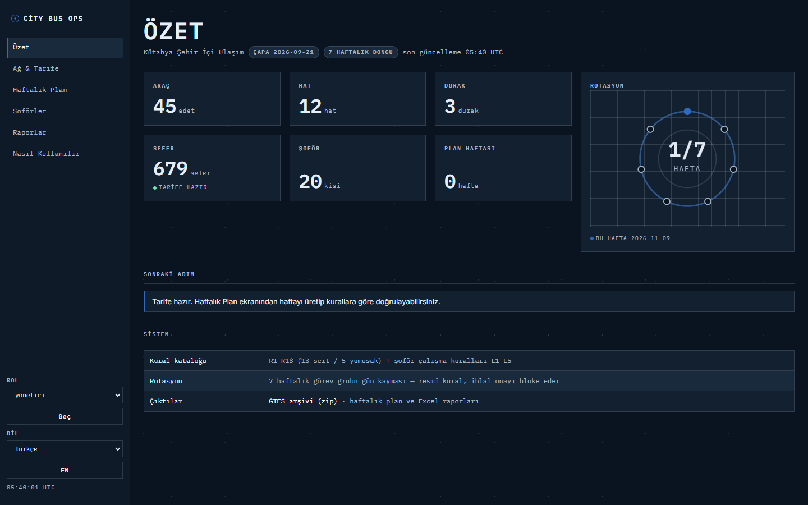
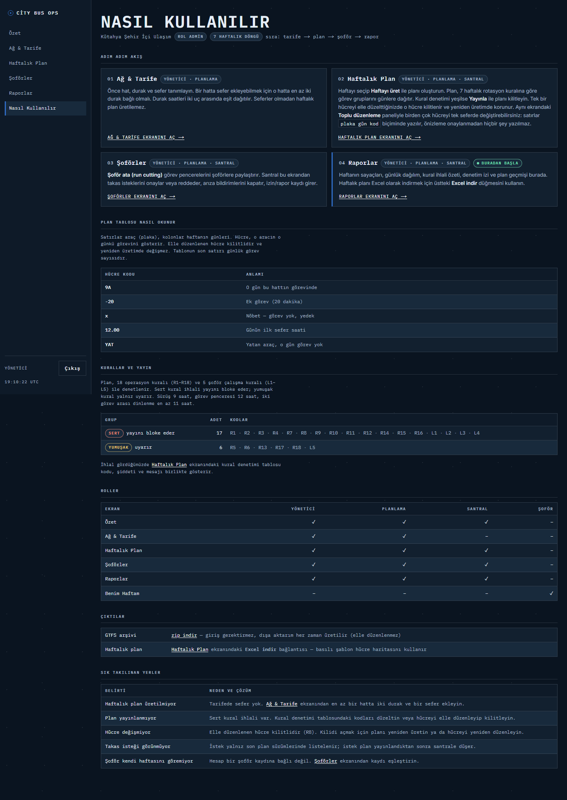

# City Bus Ops

[English](README.md) · **Türkçe**

**Belediye şehir içi otobüs filosu için araç bloklama, şoför görevleri ve 7 haftalık rotasyon kuralı — tamamen çevrimdışı çalışan bir Windows masaüstü uygulaması.**



Planlama, haftada iki kez haftalık görev planını yayınlar: hangi araç hangi hatta, hangi şoför
hangi seferi, hangi sırayla — ve bu sıra, ihlal edilmemesi gereken bir rotasyon kanununa
(erken/geç vardiyaların adil dağıtımı), yasal dinlenme sınırlarına ve operasyonun fiilen uyduğu
toplu iş sözleşmesi kurallarına tabidir.

Bu depo o aracın kendisi: tek kullanıcılı Excel akışının yerine kuralları bilen, denetim izi
tutan, şoför odasının hâlâ kullandığı basılı tabloyu aynı hücre düzeninde üreten ve gerektiğinde
tarifeyi **GTFS** olarak dışarı verebilen bir sistem.

## İndir

0.1.0 sürümünün Windows x64 derlemesi — uygulamanın tamamı tek iş istasyonunda: Electron kabuğu,
Next.js standalone sunucu ve gömülü SQLite dosyası. Sunucu yok, veritabanı servisi yok, tarayıcı yok.

| Dosya | Ne olduğu | Boyut | SHA-256 (ilk 16) |
| --- | --- | --- | --- |
| [CityBusOps-0.1.0-x64.exe](https://github.com/bahattinercan/city-bus-ops/releases/download/v0.1.0/CityBusOps-0.1.0-x64.exe) | NSIS kurulum, kullanıcı bazlı | ~103 MB | `f66fb16ae5de84e2` |
| [CityBusOps-0.1.0-portable.exe](https://github.com/bahattinercan/city-bus-ops/releases/download/v0.1.0/CityBusOps-0.1.0-portable.exe) | tek dosya, kurulum gerektirmez | ~93 MB | `f8b1bacc321758c1` |

Tam checksum listesi: [SHA256SUMS.txt](https://github.com/bahattinercan/city-bus-ops/releases/download/v0.1.0/SHA256SUMS.txt).
İndirdiğin dosyayı doğrulamak için:
`Get-FileHash ".\CityBusOps-0.1.0-x64.exe" -Algorithm SHA256`.
Tüm derlemeler: [releases](https://github.com/bahattinercan/city-bus-ops/releases).

> **Bu dosyalar imzasızdır.** Windows Smart App Control ve SmartScreen internetten indirilen imzasız
> bir exe'yi engeller — iş istasyonunda dosyayı engelden çıkarın (`Özellikler → Engellemeyi kaldır`),
> operatöre gitmeden önce kod imzalama sertifikası alın. Ayrıntı:
> [`docs/09-desktop-app.md`](docs/09-desktop-app.md).

## Neler yapar

| Alan | Yetenek |
| --- | --- |
| **Ağ ve tarife** | Hatlar, duraklar, gün tipine göre tarife (hafta içi / cumartesi / pazar), sefer bazlı kalkışlar |
| **Araç bloklama** | Hangi plaka ne zaman yolda: filoyu görevlere böl, günlük araç sayısını doğru tut |
| **Haftalık plan** | Deterministik hafta üretimi, kilitli hücre düzenleme, denetim kaydıyla yayınlama |
| **Rotasyon kanunu** | 7 haftalık görev grubu döngüsü resmî kural setiyle — ihlal yayını bloke eder, uyarı vermez |
| **Kural motoru** | 13 sert (R1–R18) + 5 yumuşak kural, ardından şoför çalışma kuralları L1–L5 (dinlenme, haftalık tavan, gece kotası) |
| **Şoförler** | Tarifeden run cutting, roster, izin, takas talebi, arıza bildirimi |
| **Şoför ekranı** | "Haftam", takas isteği, arıza bildirimi — planlama yetkisi yok |
| **Çıktılar** | Operatörün basılı haftalık tablosu (şablon v2.0 hücre haritası, Excel), GTFS Schedule zip, TODS 2.1 |
| **Asistan** | Tek Türkçe cümle → sınırlı, doğrulanmış hücre düzenleme listesi; her zaman insan onayı |
| **Dil** | Türkçe ve İngilizce arayüz; kenar çubuğundan seçilir, çerezde saklanır (varsayılan Türkçe) |
| **Kurulum** | Gömülü SQLite ile Windows kurulumu: sunucu yok, veritabanı servisi yok, tarayıcı yok |

Standartların modellemediği her şey — nöbet günleri, 7 haftalık rotasyon, ek görev kodları,
serbest metinli hücre notları — belgelenmiş `x_` ek tablolarında durur ve ham metnini korur.

## Ekranlar

| Ekran | Kim | Ne |
| --- | --- | --- |
| `/` | tüm personel | Özet: filo, sefer, rotasyon kadranı, sonraki adım, sistem kartı |
| `/network` | planlama | Hatlar, duraklar, gün tipine göre tarife |
| `/plan` | planlama, santral | Haftayı üret, kural paneli, kilitli hücre düzenleme, toplu/AI düzenleme, yayınla |
| `/drivers` | planlama, santral | Run cutting, roster, izin, takas, arıza |
| `/driver` | şoför | Haftam, takas isteği, arıza bildirimi |
| `/reports` | tüm personel | KPI, ihlaller, denetim izi, Excel indirme |
| `/help` | tüm personel | Adım adım kılavuz, hücre kodu sözlüğü, canlı kural sayıları, sorun giderme |
| `/api/gtfs` | herkese açık | GTFS Schedule zip |
| `/api/health` | operasyon | Sağlık kontrolü + gerçek veritabanı testi |



## Rotasyon ve kurallar

Plan serbest değildir: araç görev grupları yedi hafta boyunca sabit bir sırayla döner ve her
grubun vardiya deseni (erken / gündüz / geç / izin) döngüdeki konumundan türetilir. Uygulama
[`docs/legacy-data-model-and-scheduler.md`](docs/legacy-data-model-and-scheduler.md) içindeki
F1–F5 kural setini izler; erken vardiyaların döngü boyunca adil dağıtımı dahil.

`generateWeek()` ya kurala uyan bir hafta üretir ya da hangi kuralın nerede ihlal edildiğini
söyler. "Yine de yayınla" düğmesi yoktur.

```
R1–R18   operasyonel kurallar (13 sert / 5 yumuşak) → /plan üzerinde bloke eder veya uyarır
L1–L5    şoför çalışma kuralları (dinlenme, tavan, gece) → şoför × hafta bazında denetlenir
```

## Planlama asistanı

Planlama metin biçimli bir problemdir ("Salı günü 42'yi 12 hattına al, 07'yi YAT yap"), uygulama
tam olarak bunu kabul eder — üç sert sınırla:

1. **Sınırlı girdi.** Ya deterministik satırlar (`42 Salı H12`) ya tek Türkçe cümle. Modelden en
   fazla 20 hücre ve kapalı bir dilbilgisi istenir; fazlası reddedilir.
2. **Asla güvenilmez.** Yanıt savunmalı ayrıştırılır ve elle düzenlemeyle aynı kural motorundan
   geçer: bilinmeyen plaka, bilinmeyen hat kodu, tahmin edilmiş metin, çift hücre ve kural ihlali
   istisna değil, sorun listesi olur.
3. **Asla yazmaz.** Her öneri önce/sonra farkı olarak gösterilir ve ancak insan onayından sonra,
   elle düzenlemenin kullandığı kilitli hücre yazıcısıyla uygulanır.

Varsayılan olarak **kapalıdır** (`ASSISTANT_ENABLED=false`): anahtar yoksa panel yalnızca
deterministik satırları kabul eder ve hiçbir istek makineden çıkmaz. Herhangi bir
OpenAI-uyumlu uç nokta ile çalışır (ücretsiz Groq anahtarı yeter); `.env.example` üç seçeneği
kotaları ve veri saklama koşullarıyla birlikte yazar — operatör verisi için bu fark önemlidir (KVKK).

## Mimari

Uçtan uca TypeScript, pnpm workspace. `domain` saftır: React yok, Drizzle yok, ağ yok.

| Paket | Sahibi olduğu | Yapmaması gereken |
| --- | --- | --- |
| `apps/web` | Next.js App Router arayüzü, server action'lar, API rotaları | iş kuralı içermek |
| `apps/desktop` | Electron kabuğu: yaşam döngüsü, port, sağlık kapısı, yedekler, menü, paketleme | plan kuralı bilmek |
| `packages/domain` | Kural motoru, rotasyon kanunu, plan üretimi, hücre dilbilgisi, asistan sözleşmesi | React/Next/Drizzle/ağ |
| `packages/db` | Drizzle şeması (SQLite), migration'lar, seed, ham SQL | kural mantığı |
| `packages/gtfs` | GTFS + TODS okuma/yazma ve doğrulama | veritabanına dokunmak |
| `packages/xlsx` | Basılı tablo düzeni ve dışa aktarma | veritabanını bilmek |

Teknoloji: Node 22 · pnpm 12 · Next.js 16 + React 19 · SQLite (`better-sqlite3`) + Drizzle ORM ·
Electron 38 · ExcelJS 4 · GTFS/TODS 2.1 · Vitest 5 (**146 test**).

## Hızlı başlangıç

```bash
pnpm install
cp .env.example .env       # CITYBUS_DB_FILE, SESSION_SECRET — gerisi isteğe bağlı
pnpm --filter @citybus/web dev
```

<http://localhost:3000> adresini açın. İlk istek SQLite dosyasını oluşturur, temel migration'ı
uygular ve referans veriyi yükler (45 plaka, 12 hat, 4 görev grubu, 20 demo şoför ve demo tarife).

**Arayüz dili.** Arayüz Türkçe (operatör varsayılanı) ve İngilizce gelir; kenar çubuğundaki
seçici `cb_lang` çerezini yazar, böylece her ekran, kural adı, ihlal cümlesi ve hata mesajı seçilen
dilde görünür. Sözlük anahtarları birbirine göre tip denetiminden geçer: eksik bir İngilizce metin
ham anahtar olarak görünmez, derlemeyi kırar.

**Masaüstü (yerel) mod — giriş yok.** Çalışma rolü kenar çubuğundan seçilir (yönetici / planlama /
santral / şoför, varsayılan yönetici); depo bilgisayarının başında oturan birine şifre bir şey
kanıtlamaz. Şifreli giriş, `CITYBUS_LOCAL_MODE` tanımsızken çalışan web/sunucu varyantı için durur.

### Masaüstü uygulaması

```bash
pnpm desktop:package     # Next standalone → sahnelenen sunucu → Electron kabuğu → kurulumlar
```

Çıktı `apps/desktop/release/` altında: `City Bus Ops-<sürüm>-x64.exe` (NSIS kurulum, ~103 MB) ve
`City Bus Ops-<sürüm>-portable.exe` (~93 MB). Yayınlanan release dosyaları aynı içeriği tiresi adla
(`CityBusOps-<sürüm>-x64.exe`, `CityBusOps-<sürüm>-portable.exe`) taşır — bkz. [İndir](#i̇ndir) / [releases](https://github.com/bahattinercan/city-bus-ops/releases).
Veri, yedek ve günlükler kullanıcının yanında kalır:
`%APPDATA%\CityBusOps\` — `citybus.db`, `backups/` (açılış ve kapanışta alınan 14 dönen kopya),
`logs/`. `pnpm desktop:self-test` tüm yığını başsız ayağa kaldırıp JSON rapor basar; CI kapısı budur.

> **Yayın kapısı:** kurulum imzasızdır. Windows Smart App Control internetten indirilen imzasız
> exe'yi engeller; operatöre dağıtım için kod imzalama sertifikası gerekir
> ([`docs/09-desktop-app.md`](docs/09-desktop-app.md)).

## Doğrulama

```bash
pnpm verify                                  # lint + typecheck + test + build — kapı
BASE=http://127.0.0.1:3000 scripts/smoke.sh  # çalışan uygulamaya karşı uçtan uca
```

`pnpm verify` yeşil olmadan hiçbir iş "bitti" sayılmaz. Smoke betiği gerçek akışları (plan üretimi,
run cutting, hücre düzenleme, Excel, GTFS, rol korumaları) taze bir veritabanı dosyasına karşı
denetler; paketlenmiş kaynaklara karşı da koşar, yani sevk edilen baytlar test edilir.
Demo veri, hesaplar ve elle gezinme: [`TESTING.md`](TESTING.md).

## Veri, gizlilik, çevrimdışı

- Tek iş istasyonu, tek SQLite dosyası; yönetilecek sunucu yok, veri makineden çıkmaz.
- Asistan açıkça etkinleştirilmedikçe **ve** planlama onu kullanmadıkça hiçbir yere istek gitmez.
- Veritabanı, yapılandırma ve yedekler `%APPDATA%\CityBusOps\` altında, depo dışında durur.
  `.env`, `.secrets/` ve `*.db` git tarafından yok sayılır; hiçbir kimlik bilgisi commit edilmez.
- Operasyonel gerçek kendi tablolarımızdadır. GTFS ve TODS **üretilen** çıktılardır; içe aktarma
  bir göç aracıdır, düzenleme yolu asla değildir.

## Depo düzeni

```
apps/web            Next.js uygulaması: ekranlar, server action'lar, API, oturum
apps/desktop        Electron kabuğu: yaşam döngüsü, yedekler, paketleme, self-test
packages/domain     kurallar, rotasyon, plan üretimi, hücre dilbilgisi, asistan sözleşmesi
packages/db         Drizzle şeması (SQLite), migration'lar, seed
packages/gtfs       GTFS + TODS okuma/yazma ve doğrulama
packages/xlsx       basılı haftalık tablo, şablon v2.0 hücre haritası
docs/               tasarım dokümanları; legacy-*.md eski sistemin dondurulmuş kaydı
tests/              paketler arası golden dosyalar ve e2e fixture'ları
```

## Yol haritası

- Kurulum için **kod imzalama** (bugün dağıtımı bu engelliyor).
- Otomatik güncelleme akışı ve markalı simge.
- İlk açılış sihirbazı: kurum adı, rotasyon çapa haftası, filo içe aktarma (CSV/XLSX).
- Canlı veri: depo AVL beslemesi geldiğinde GTFS-RT üretici.
- İsteğe bağlı çok kullanıcılı sunucu modu (şifreli varyant kod tabanında duruyor).

## Lisans

[Apache License 2.0](LICENSE) — kullanın, değiştirin, dağıtın; bildirimleri ve patent iznini koruyun.
Seed'deki hat adları, plakalar ve şoför isimleri kurgusal demo verisidir.

## Dokümantasyon

| Dosya | İçerik |
| --- | --- |
| [`docs/02-data-model.md`](docs/02-data-model.md) | Üç katmanlı model, `x_` ek şema alanı |
| [`docs/07-design-system.md`](docs/07-design-system.md) | Token'lar, yerleşim, bileşen kuralları, arayüz dili |
| [`docs/08-assistant.md`](docs/08-assistant.md) | Asistan sözleşmesi, doğrulama, gizlilik |
| [`docs/09-desktop-app.md`](docs/09-desktop-app.md) | Masaüstü kararları, paketleme, tuzaklar, yayın kapısı |
| [`docs/legacy-domain-analysis.md`](docs/legacy-domain-analysis.md) | Eski tabloların envanteri, operatör kararları O1–O5 |
| [`docs/legacy-data-model-and-scheduler.md`](docs/legacy-data-model-and-scheduler.md) | Kural kataloğu R1–R18, rotasyon kanunu F1–F5 |
| [`docs/legacy-excel-io.md`](docs/legacy-excel-io.md) | Basılı haftalık tablonun hücre haritası |
| [`TESTING.md`](TESTING.md) | Demo veri, hesaplar, gezinme, smoke betiği |
| [`README.md`](README.md) | Bu belgenin İngilizcesi |

`legacy-*.md` belgeleri eski sistemden birebir alınmıştır ve Türkçe kalır: başka hiçbir yerde
yazılı olmayan kuralların tek kaydıdır. Dondurulmuştur — yeni fikirler yeni bir belgeye yazılır.
